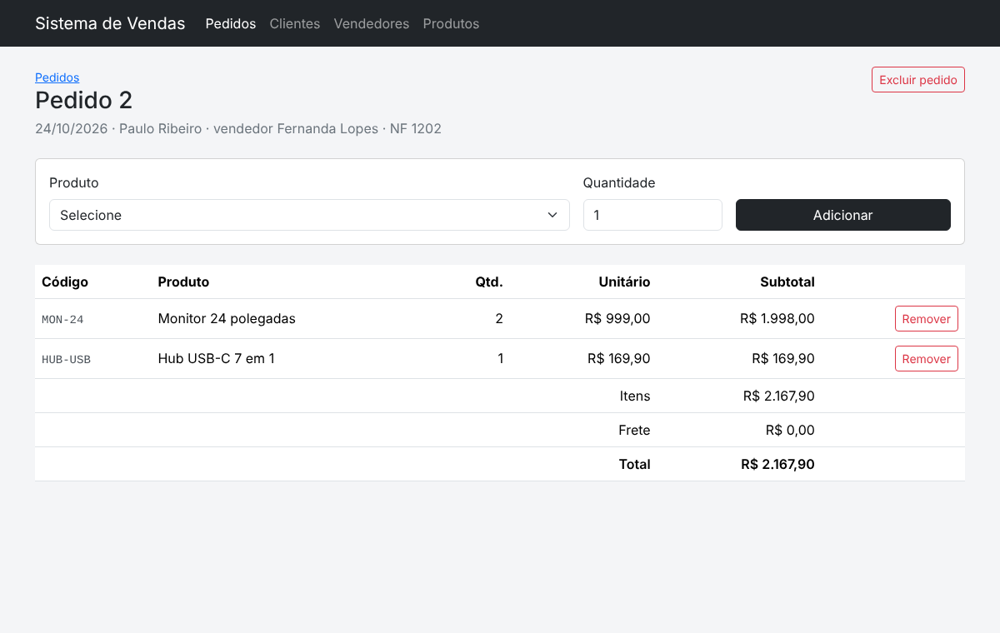
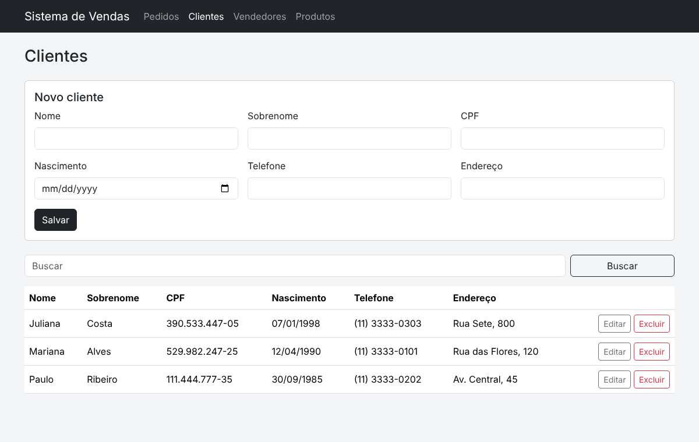

# Sistema de Vendas

Cadastro de clientes, vendedores e produtos, com pedidos que dão baixa no estoque. PHP + MySQL.

Começou como trabalho do curso técnico no SENAI (2022) e foi reescrito do zero com o que aprendi depois. A versão original continua em [aulasSenai_2022](https://github.com/leoCasteletti/aulasSenai_2022/tree/main/php/mvc2).



## Funcionalidades

- Clientes, vendedores e produtos com busca, edição e exclusão
- Validação de CPF (dígitos verificadores), e-mail, datas e valores em reais
- Pedido com itens: o estoque baixa ao adicionar e volta ao remover ou excluir
- Total do pedido com frete
- Não deixa excluir cliente ou vendedor que tenha pedido



## O que mudou da versão do curso

| Antes | Agora |
|---|---|
| SQL montado com variáveis do formulário | PDO com `prepared statements` |
| Conexão repetida em cada arquivo | Uma classe de conexão, configurada por variável de ambiente |
| Valores impressos direto na tela | Tudo escapado com `htmlspecialchars` |
| Datas e preços como texto | `DATE` e `DECIMAL`, com validação |
| Sem proteção de formulário | Token CSRF em todo `POST` |
| Estoque sem controle | Baixa e devolução em transação |
| Sem testes | 17 testes rodando no GitHub Actions |

## Rodando

**Com MySQL (XAMPP)**

1. Importar `database.sql`
2. `php -S localhost:8000 -t public`

Conexão padrão: `localhost`, banco `vendas`, usuário `root`, sem senha. Para mudar, use `VENDAS_DSN`, `VENDAS_USUARIO` e `VENDAS_SENHA`.

**Sem instalar nada (SQLite)**

```bash
export VENDAS_DSN=sqlite:vendas.db
php bin/demo.php
php -S localhost:8000 -t public
```

`bin/demo.php` cria o banco e alguns dados de exemplo.

## Testes

```bash
php tests/run.php
```

## Estrutura

```
public/    ponto de entrada, CSS e Bootstrap
src/       Banco, Validacao, Cadastros, Pedidos
views/     telas
bin/       dados de demonstração
tests/     testes com SQLite em memória
```

## Stack

PHP 8.1+ · PDO · MySQL / SQLite · Bootstrap 5 · GitHub Actions
